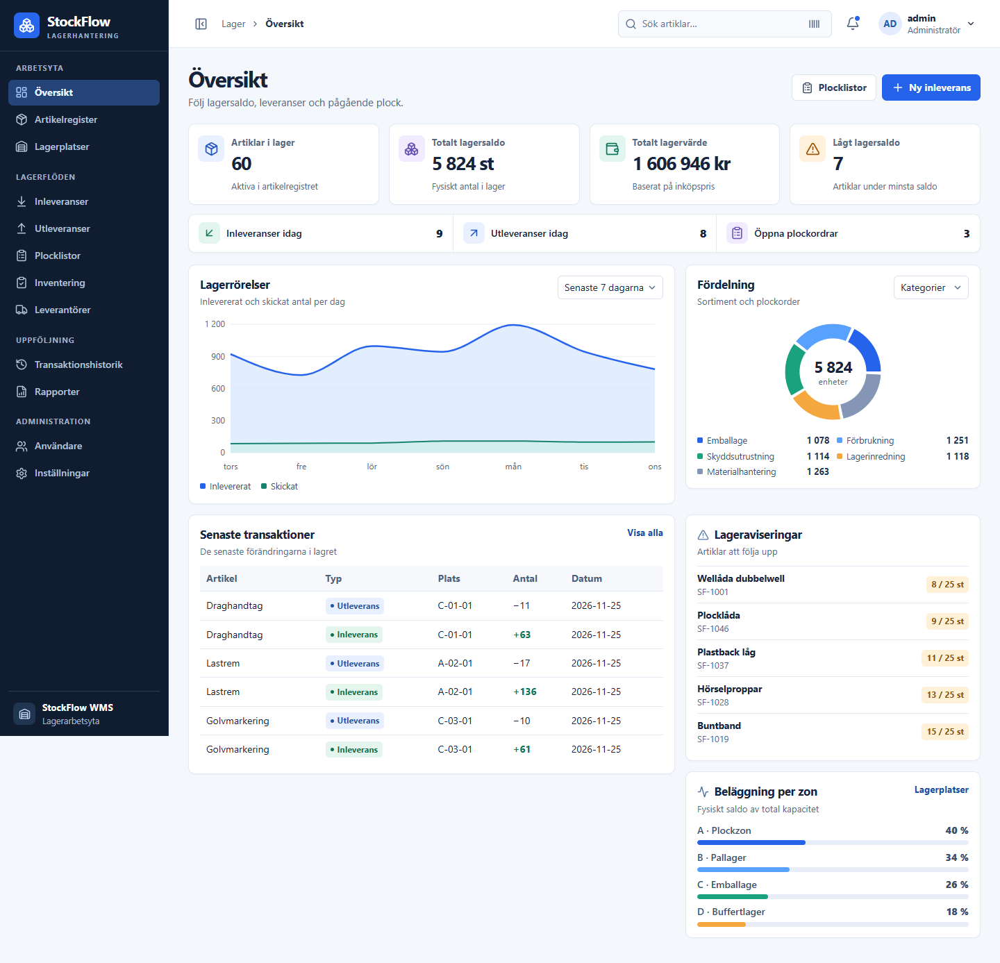

# StockFlow WMS

StockFlow är ett fiktivt lagerhanteringssystem för ett mindre svenskt lager. Idén bakom projektet kommer från mitt nuvarande arbete på lager. Jag ville kombinera min erfarenhet av lagerarbete med systemutveckling och skapa ett system som underlättar det dagliga arbetet.

Systemet har artikelregister med utskrivbara streckkoder, lagerplatser och interna flyttar, in- och utleveranser, plocklistor, inventering, leverantörer, transaktionshistorik och rapporter med CSV-export. Översikten hämtar lagervärde, saldon och flöden från databasen. De tre användarrollerna har olika behörigheter i både gränssnittet och API:t.

## Skärmbilder



| Vy | Bild |
| --- | --- |
| Översikt | [Öppna översikten](docs/screenshots/oversikt.png) |
| Artikelregister | [Öppna artikelregistret](docs/screenshots/artikelregister.png) |
| Plocklista | [Öppna plocklistan](docs/screenshots/plocklista.png) |
| Inleveranser | [Öppna inleveranser](docs/screenshots/inleveranser.png) |
| Mobil | [Öppna mobilvyn](docs/screenshots/mobil.png) |

## Kör lokalt

Öppna projektroten i två PowerShell-fönster. Starta API:t i Ubuntu via WSL.

```powershell
wsl -d Ubuntu -- bash -lc 'ASPNETCORE_ENVIRONMENT=Development ~/.dotnet/dotnet run --project backend --no-launch-profile --urls http://127.0.0.1:5081'
```

Byt ut `~/.dotnet/dotnet` mot `dotnet` om SDK:t finns i Ubuntus PATH.

```powershell
cd frontend
npm.cmd ci
npm.cmd run dev
```

Öppna [StockFlow](http://127.0.0.1:5174). API:t körs på [port 5081](http://127.0.0.1:5081/api/health), med [OpenAPI](http://127.0.0.1:5081/openapi/v1.json) i utvecklingsläge. API:t kör databasmigreringar vid start. När demodata är aktiverade fylls en tom utvecklingsdatabas med 60 fiktiva artiklar och exempelflöden.

| Roll | Användarnamn |
| --- | --- |
| Administratör | `admin` |
| Arbetsledare | `arbetsledare` |
| Lagermedarbetare | `lager` |

Dessa fiktiva utvecklingskonton använder lösenordet `StockFlow!2026`. Demodata och demokonton skapas endast i utvecklingsläge. Sätt miljövariabeln `SeedDemo=false` före start för att hoppa över dem. Redan skapade demokonton finns kvar i databasen.

## Teknik och tester

C# och ASP.NET Core 10, Identity, EF Core och SQLite. React och TypeScript med Vite, React Router, Tailwind CSS, Lucide och Recharts. xUnit kör API-integrationstester mot en tillfällig SQLite-databas. Playwright kör mot den riktiga appen och kräver installerad Chrome. Webbläsartestet skapar egna poster i den lokala utvecklingsdatabasen.

```powershell
wsl -d Ubuntu -- bash -lc '~/.dotnet/dotnet test tests'
cd frontend
npm.cmd run lint
npm.cmd run build
npm.cmd test
npm.cmd run e2e
```

## Avgränsningar

Demon använder ett lager och SQLite. Streckkodsläsaren behöver kunna skriva som ett tangentbord. Historiskt lagervärde använder dagens inköpspriser. Produkt- och leverantörsposter arkiveras för att bevara spårbarheten. Produktionsdrift behöver en separat, tom databas, en första administratör och HTTPS framför webbgränssnittet och API:t.
